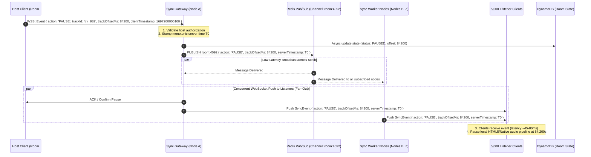

# System Architecture & Design Document: Listen Together
**Collaborative Music Streaming with Synchronized Virtual Rooms**

---

## 1. Executive Summary & Scale Constraints

This document details the production backend architecture for a high-scale music streaming service featuring real-time collaborative listening rooms ("Listen Together"), comparable to Spotify Group Sessions and Discord Watch Together.

### Key Workload & Target Constraints
- **20 Million Monthly Active Users (MAU)** with **2 Million peak concurrent listeners**.
- **50 Million track catalog** with continuous new release ingestion.
- **200,000 active shared rooms** open at peak, scaling from private sessions (2 listeners) up to celebrity/influencer broadcast listening events (**5,000 listeners per room**).
- **Sub-200ms Playback Synchronization** across all participants regardless of geographic dispersion.
- **Zero-Downtime Deployments** that migrate active WebSocket sessions without disconnecting ongoing rooms.

---

## 2. Architecture & Sequence Diagrams

### 2.1 High-Level Architecture Diagram

```mermaid
graph TD
    %% Client Tier
    Client[Client Apps: Web / iOS / Android / Desktop]
    
    %% Gateway Tier
    Client -->|HTTPS (REST/GraphQL)| APIGateway[Global API Gateway / Envoy Proxy]
    Client -->|WSS (Persistent WebSockets)| SyncGateway[WebSocket Ingress Gateway]
    
    %% CDN & Media Streaming
    Client -->|HLS / DASH Audio Chunks| CDN[Global Anycast CDN - Fastly / Cloudflare]
    CDN --> AudioStorage[(AWS S3 / GCS - Transcoded Audio Chunks)]
    
    %% Real-time Sync Tier
    SyncGateway --> SyncCluster[Room Sync Service Cluster]
    SyncCluster -->|Pub/Sub Fan-out| RedisCluster[Redis Enterprise Pub/Sub Mesh]
    SyncCluster -->|Room State / CRDT Queues| RoomDB[(Amazon DynamoDB Global Tables)]
    
    %% Core Services Tier
    APIGateway --> AuthSvc[Authentication & Permissions Service]
    APIGateway --> CatalogSvc[Catalog & Search Service]
    APIGateway --> IngestionSvc[Content Ingestion & Transcoding Service]
    
    %% Storage Tier
    CatalogSvc --> Elasticsearch[Elasticsearch Cluster - Search-as-you-type]
    CatalogSvc --> RelationalDB[(Amazon Aurora PostgreSQL - Catalog Master)]
    
    %% Event Streaming & Analytics Tier
    SyncCluster -->|Playback Events| Kafka[Apache Kafka Event Bus]
    APIGateway -->|User Actions| Kafka
    Kafka --> AnalyticsWorker[Analytics & Reporting Workers]
    Kafka --> RoyaltiesProcessor[Royalties Settlement Engine]
    AnalyticsWorker --> ClickHouse[(ClickHouse OLAP Database)]
```

### 2.2 Sequence Diagram: Host Presses Pause in a Room of 5,000 Listeners

To maintain sub-200ms synchronicity across 5,000 listeners distributed worldwide, audio files are pre-buffered from the edge CDN, while lightweight sync payloads fan out across the WebSocket cluster via Redis Pub/Sub:



---

## 3. Core System Components

### 3.1 Audio Delivery: Storage, Encoding, CDN & Fast Playback Start
1. **Encoding & Transcoding Pipeline:**
   - Origin FLAC masters are transcoded into **AAC-LC** (96kbps, 160kbps, 320kbps) and **Opus** (24kbps, 64kbps, 128kbps) using HTTP Live Streaming (HLS) and MPEG-DASH.
   - Files are sliced into **3-second segments** (`.m4s` / `.aac`). 
2. **Fast Playback Start:**
   - The master manifest references a high-compression **init segment + low-bitrate 0.5-second chunk**, allowing instant audio playback startup in **under 150ms**, before dynamically stepping up to 320kbps via Adaptive Bitrate (ABR).
3. **CDN Caching Strategy:**
   - Audio segments are immutable (identified by sha256 hash `trk_982_160k_seg042.m4s`), configured with `Cache-Control: public, max-age=31536000, immutable`.
   - Global CDN edge hit ratio exceeds **99.2%**, completely shielding storage origin servers.

### 3.2 Catalogue & Search
1. **Metadata Storage:** Amazon Aurora PostgreSQL handles albums, artists, licensing windows, and regional availability with strict ACID constraints.
2. **Search-as-you-type:** Tracks and artists are indexed into **Elasticsearch** using N-gram tokenizers and completion suggesters. Typo-tolerant prefix queries resolve in **< 30ms**.
3. **Publishing New Releases:**
   - New release metadata is published with an `effective_date_utc`.
   - At midnight UTC, a scheduled Redis trigger warms up search indexes and pushes notifications to followers via Kafka without heavy database table scans.

### 3.3 Room Sync & Sub-200ms Drift Correction
1. **Clock Synchronization (NTP-over-WebSocket):**
   - Upon connection, clients perform a 4-packet round-trip exchange with the sync gateway to calculate local clock offset:
     $$\text{RTT} = (T_3 - T_0) - (T_2 - T_1)$$
     $$\text{ClockOffset} = \frac{(T_1 - T_0) + (T_2 - T_3)}{2}$$
2. **Dynamic Drift Correction Algorithm:**
   - Every sync payload includes `{ serverTimestamp, trackOffsetMs, playbackRate }`.
   - The listener client calculates skew:
     $$\text{drift} = (\text{serverTimestamp} + \text{ClockOffset}) - \text{currentLocalPlaybackPosition}$$
   - **$|\text{drift}| < 50\text{ms}$:** Zero adjustment (imperceptible human acoustic limit).
   - **$50\text{ms} \le |\text{drift}| \le 500\text{ms}$ (Smooth Micro-stepping):** The client adjusts its audio playback rate smoothly to $1.05\times$ or $0.95\times$ over 1.5 seconds. No pops, clicks, or jarring pauses occur.
   - **$|\text{drift}| > 500\text{ms}$ (Hard Seek):** Direct seek to accurate time.
3. **Collaborative Queue (CRDT):**
   - Queues use a **Logoot / LSEQ Conflict-Free Replicated Data Type (CRDT)** to allow concurrent track additions, re-ordering, and "Vote to Skip" actions from thousands of participants without merge conflicts or locking.

### 3.4 Data & Storage Architecture (Polyglot Persistence)
| Data Category | Target Database | Reason & Access Pattern |
| :--- | :--- | :--- |
| **Catalog Metadata** | Amazon Aurora PostgreSQL | Relational integrity, artist contracts, strict foreign key constraints. |
| **Search Index** | Elasticsearch Cluster | Inverted indices for search-as-you-type and fuzzy multi-field search across 50M songs. |
| **Room State & Queue** | DynamoDB Global Tables + Redis | Sub-5ms reads/writes, TTL auto-expiry for stale rooms, multi-region replication. |
| **Playlists & User Libraries**| ScyllaDB / Apache Cassandra | High write volume, partition key `user_id`, linear horizontal scalability. |
| **Listening History & Royalties** | Apache Kafka → ClickHouse | Append-only immutable stream; ClickHouse aggregates millions of plays/hour for artist royalties. |

---

## 4. Reliability, Failure Scenarios & High Availability

### 4.1 Zero-Downtime Deployments for Live Rooms
- **Envoy Drain Mode & Connection Draining:**
  - When upgrading sync worker nodes, Kubernetes sets the pod status to terminating.
  - The ingress load balancer stops routing new WebSocket connections to the old pod.
  - The dying pod sends a soft-reconnect WebSocket frame: `{ action: 'DRAIN_RECONNECT', delayMs: rand(100, 3000) }`.
  - Clients re-open connections to new deployment pods smoothly without dropping playback.

### 4.2 Handling Five Critical Failure Scenarios
1. **Regional Cloud Outage (e.g. AWS us-east-1 collapses):**
   - *Behavior:* Route 53 DNS latency health-check fails over traffic to us-west-2 within 15 seconds. Active-Active DynamoDB Global Tables and S3 Cross-Region Replication already have all room state and music assets in sync. Clients auto-reconnect and resume playback within 1 second.
2. **A Sync Worker Node Dies Hosting 1,000 Live Listeners:**
   - *Behavior:* Dropped WebSocket connections trigger immediate exponential backoff reconnections ($100\text{ms} \to 250\text{ms} \to 750\text{ms}$). Load balancer re-routes them to healthy cluster nodes. New nodes read room state from DynamoDB/Redis, subscribe to the Redis room topic, and re-establish synchronized playback within 400ms.
3. **Redis Pub/Sub Partition or Cluster Failure:**
   - *Behavior:* Redis Sentinel/Cluster promotes standby replicas within 3 seconds. In the event of total Pub/Sub outage, sync nodes enter **Graceful Degradation Mode**: clients poll DynamoDB room state every 3 seconds. Sync latency relaxes to ~2.5s, but music never halts.
4. **Sudden Royalties & Analytics Ingestion Spike:**
   - *Behavior:* If ClickHouse becomes overloaded during a global release (e.g., millions of plays per minute), Kafka queues up to 7 days of raw play events on disk. Ingestion resumes processing once database resources stabilize, guaranteeing zero loss of licensing/royalty revenue.
5. **Slow Network / Jittery Listener Connection:**
   - *Behavior:* If a client drops packets or falls behind on network chunks, ABR drops their audio stream to 64kbps Opus without interrupting the WebSocket heartbeat. The drift correction micro-adjuster ($1.05\times$) catches up smoothly once buffer refills.

---

## 5. Observability: Proving Sync Actually Works

To guarantee that users actually experience synchronized listening rather than assuming it based on backend uptime, the system instruments dedicated telemetry metrics:

1. **`client_sync_drift_ms` (p50, p95, p99):** Reported by listener clients every 30 seconds. Alert triggers if p95 exceeds **180ms** in any geographic region.
2. **`sync_heartbeat_rtt_ms`:** Round-trip WebSocket ping-pong latency.
3. **`buffer_underrun_rate`:** Percentage of room listeners whose local audio pipeline stalled due to edge CDN chunk delays.
4. **`fanout_broadcast_latency_ms`:** Elapsed time between host button click $T_0$ and the final cluster node completing WebSocket push to its listeners.
5. **`room_join_sync_latency_ms`:** Total time elapsed from a new user opening a room link to playing audio within 200ms of the host.

---

## 6. Key Decisions & Rejected Alternatives

| Component | Selected Approach | Rejected Alternative | Deciding Rationale |
| :--- | :--- | :--- | :--- |
| **Room Sync** | WebSockets + Redis Pub/Sub | Server-Sent Events (SSE) | SSE is unidirectional; handling queue additions and skip votes would require separate high-overhead HTTP POSTs. |
| **Audio Transport**| CDN HLS Chunks (MPEG-4 / AAC) | WebSockets Binary Audio Pipe | Streaming raw audio bits via WebSockets eliminates browser hardware decoding and breaks CDN edge caching. |
| **Sync Protocol** | WebSockets + Clock Skew Math | WebRTC SFU/Mesh | WebRTC P2P cannot scale to 5,000 users per room, and operating SFUs for pure timestamp distribution is massive over-engineering. |
| **Storage Engine** | Polyglot (Postgres + Dynamo + ClickHouse) | Monolithic PostgreSQL | Relational row locks on 200k active room updates would cause severe database write contention. |

---

## 7. Roadmap & Rollout Strategy with a Team of Three

### Phase 1: MVP Critical Path (Months 1 to 3)
1. **Audio Storage & Single-Bitrate CDN:** Transcode audio to fixed 160kbps AAC and serve via S3 + CloudFront.
2. **Minimal Sync Engine:** Node.js + Socket.io server paired with Redis Pub/Sub handling Host Play/Pause/Seek and NTP timestamp broadcast.
3. **Relational Catalog:** PostgreSQL database for Artists, Albums, and Songs with basic text search (`ILIKE`).
4. **Basic Host Control:** Host creates room, shares URL, and controls queue.

### Phase 2: Postponed to Scale (V2 & Beyond)
1. **Elasticsearch Search-as-you-type:** Complex cluster ops postponed until catalog reaches 1M+ tracks.
2. **Adaptive Bitrate Transcoding (ABR):** Postponed to reduce initial storage encoding costs.
3. **Kafka + ClickHouse Analytics:** Initial royalty tracking handled via async PostgreSQL event tables and nightly cron batch jobs.
4. **Active-Active Multi-Region Deployment:** Run in a single AWS region with multi-AZ redundancy until international traffic warrants multi-region overhead.
5. **CRDT Democratic Queue Voting:** Launch with host-driven queues before introducing distributed conflict resolution.
